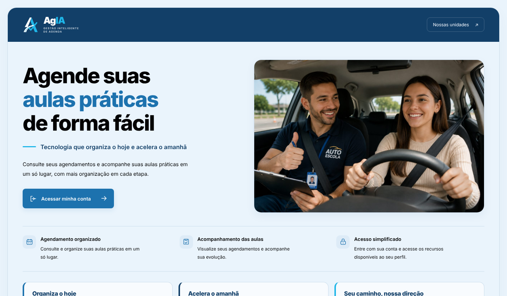
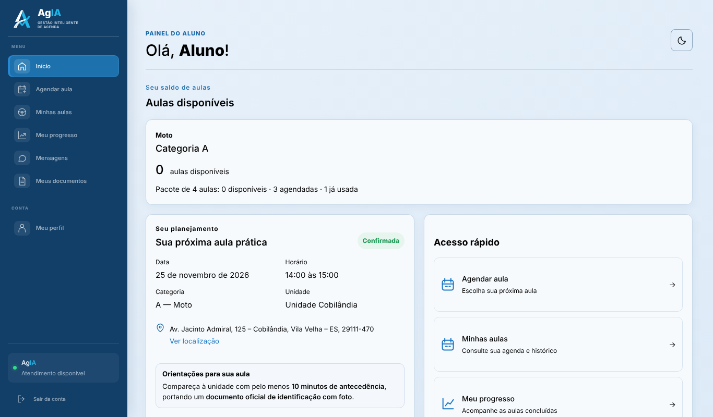
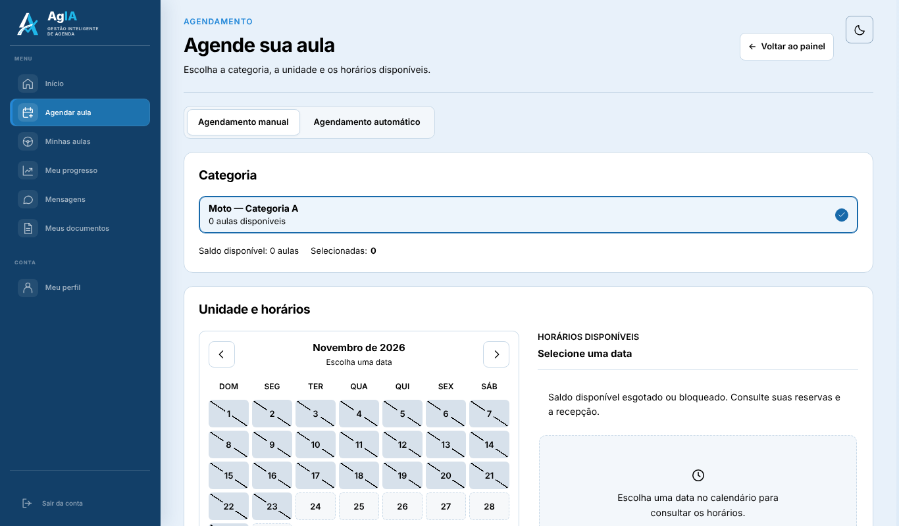
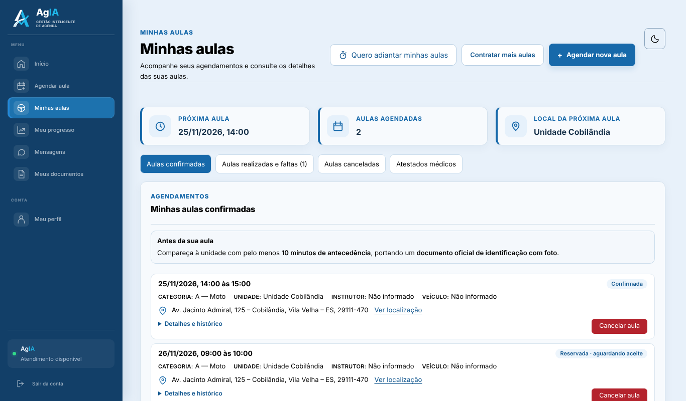
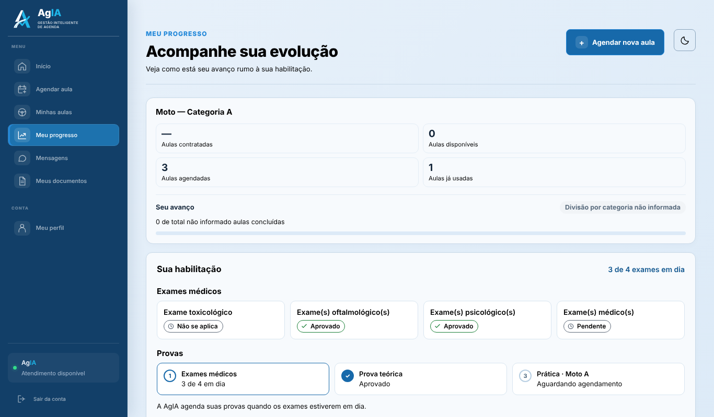
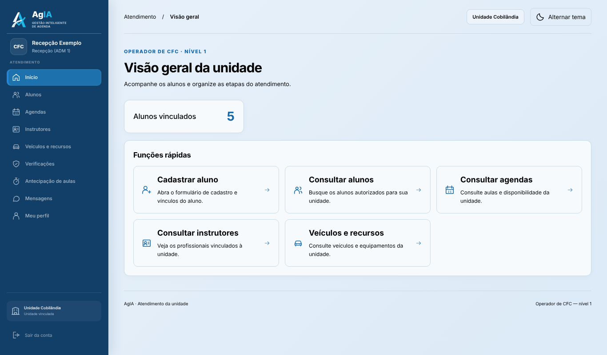
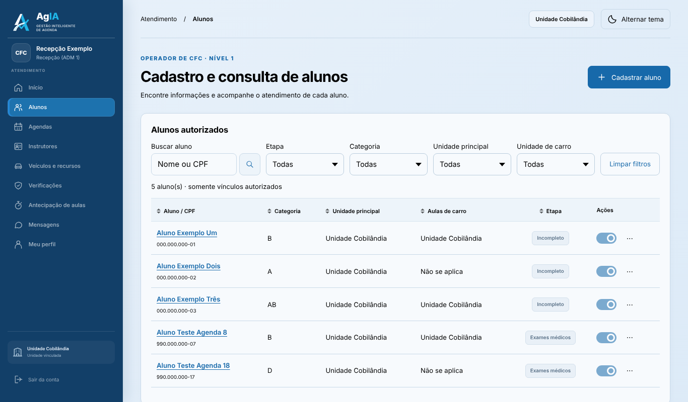
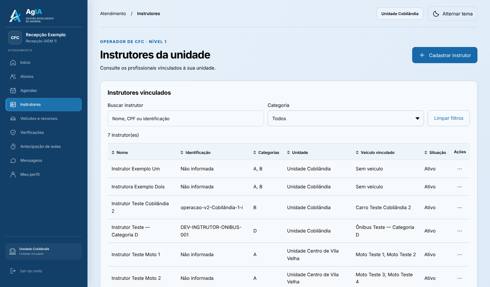
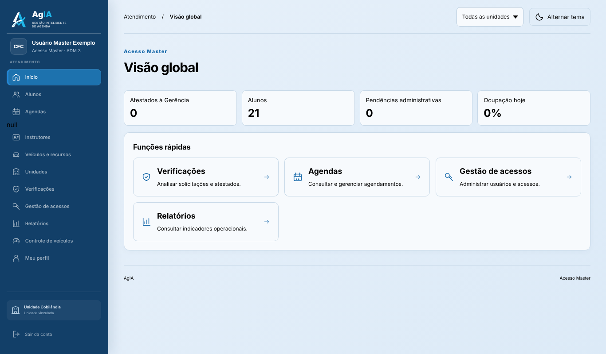
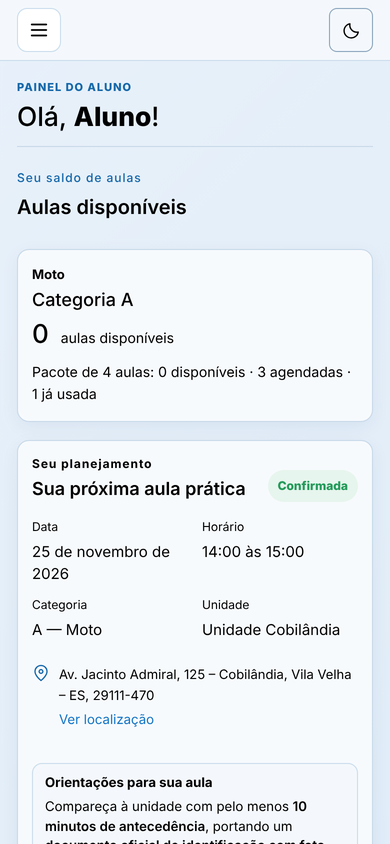

# agIA — Gestão Inteligente de Agenda

Sistema web de gestão de aulas práticas para autoescolas, criado para a **Autoescola KM** (Vila Velha – ES). Ele reúne em um só lugar o agendamento de aulas, a agenda dos instrutores, o acompanhamento dos alunos e a administração das unidades.

> Este repositório é uma **apresentação** do projeto. Todas as imagens foram geradas com **dados fictícios**. O sistema está em fase final de desenvolvimento e validação para implantação.



---

## O problema

Uma autoescola com várias unidades precisa coordenar alunos, instrutores, veículos e horários ao mesmo tempo. Trabalhando na operação da Autoescola KM, identifiquei essas necessidades e propus um sistema que centralizasse tudo: quem pode agendar, quando, com qual instrutor e veículo, e o que acontece em cancelamentos, faltas e reposições.

## O que o sistema faz

**Aluno**
- Agendamento de aulas por categoria, unidade, data e horário disponíveis (manual ou automático)
- Consulta das aulas confirmadas, realizadas, faltas e cancelamentos
- Acompanhamento do progresso: aulas usadas, exames médicos e provas
- Envio de atestados, mensagens com a recepção e pedido de antecipação de aulas

**Instrutor**
- Agenda do dia, registro de presença e falta, histórico de aulas e avaliações

**Recepção, Gerência e Master (3 níveis administrativos)**
- Cadastro e consulta de alunos, instrutores, veículos e recursos
- Agendas por instrutor e por unidade, realocação e substituição de aulas
- Verificações médicas, dias de prova, relatórios e gestão de acessos
- Visão global de todas as unidades (Master)

## Regras de negócio implementadas

- Categorias A, B, AB e D, com saldo de aulas separado por categoria
- Cancelamento com antecedência mínima de 48 horas úteis
- Aulas de 50 minutos, respeitando expediente, horário de almoço do instrutor, feriados e bloqueios
- Permissões por perfil e por unidade: cada nível só acessa o que lhe cabe
- Registro de presença e falta com confirmação, sem descontar a mesma aula duas vezes

---

## Telas

| Painel do aluno | Agendamento |
|---|---|
|  |  |

| Minhas aulas | Progresso do aluno |
|---|---|
|  |  |

| Recepção: visão geral | Recepção: alunos |
|---|---|
|  |  |

| Recepção: instrutores | Master: visão global |
|---|---|
|  |  |

**Versão para celular**



---

## Tecnologias

| Camada | Tecnologias |
|---|---|
| Front-end | HTML5, CSS3 e JavaScript puro (módulos ES), sem frameworks |
| Interface | Layout responsivo, tema claro e escuro, componentes reutilizáveis |
| Integração | API REST em C#/.NET com autenticação por token (Bearer) |
| Banco de dados | SQL Server |
| Relatórios | Exportação em PDF (jsPDF), Excel e CSV |
| Qualidade | 271 testes automatizados e 555 verificações de navegador |
| Versionamento | Git e GitHub |

## Arquitetura do front-end

```
aluno/              Painel do aluno
instrutor/          Painel do instrutor
nivel-1-operador/   Recepção
nivel-2-gerencia/   Gerência
nivel-3-master/     Administração global
shared/             Componentes, regras, serviços HTTP, temas e relatórios
  js/api.js         Cliente HTTP: token, tratamento de erros e paginação
  js/services/      Um serviço por recurso da API (alunos, agendamentos, pacotes...)
tests/              Testes automatizados e de navegador
```

As telas não falam direto com a API: cada uma usa um **serviço** (`agendamentos.service.js`, `alunos.service.js`...), que por sua vez usa um **cliente HTTP único** (`api.js`). Assim, regras de autenticação, erros e sessão expirada ficam num só lugar.

## Meu papel no projeto

- Identifiquei a necessidade na operação da autoescola e idealizei o sistema
- Levantei os requisitos e defini as regras de negócio
- Desenvolvi o front-end completo (HTML, CSS e JavaScript)
- Apoiei o desenvolvimento do back-end em C#/.NET e a estruturação do banco SQL Server, junto ao desenvolvedor responsável pela API

---

**Matheus Henrique Alves Corrêa** — [LinkedIn](https://www.linkedin.com/in/matheus-henrique-alves-correa-299855365) · [GitHub](https://github.com/teteusalvescorrea-hub)
